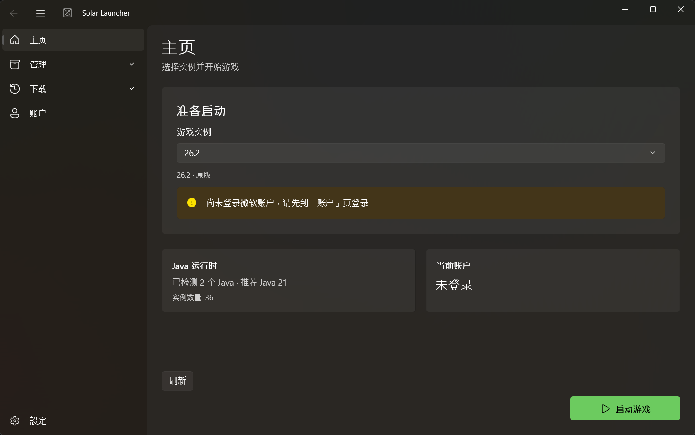
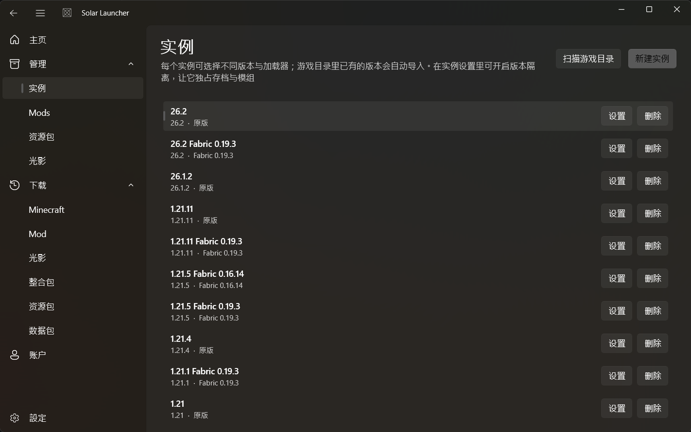
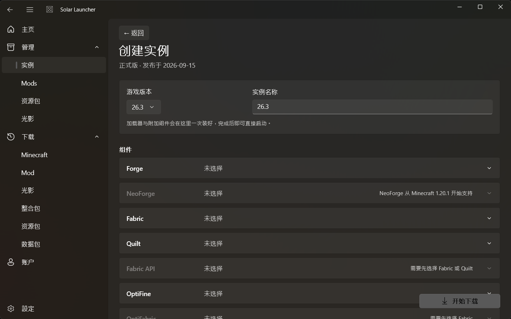
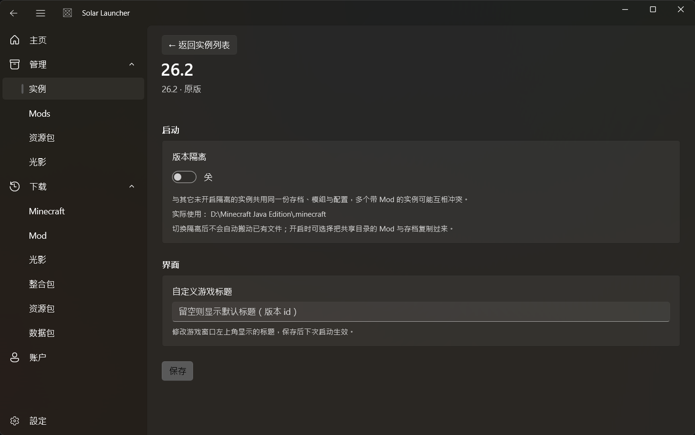
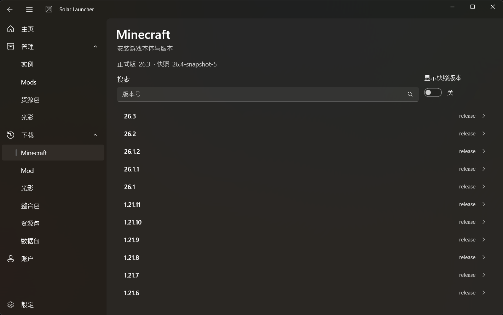
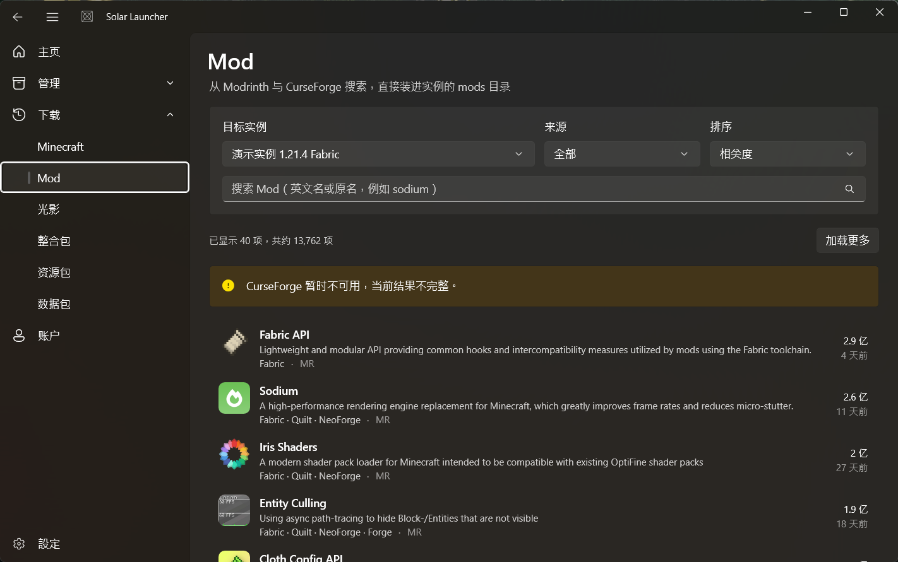
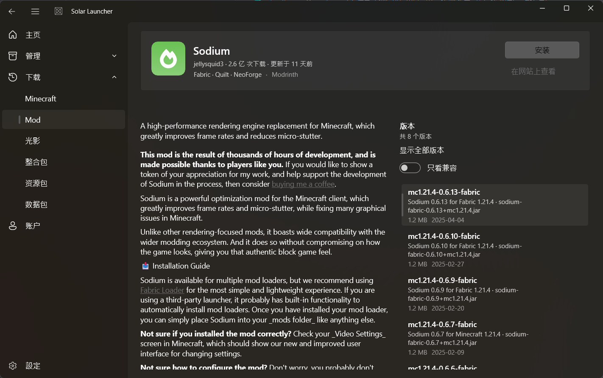
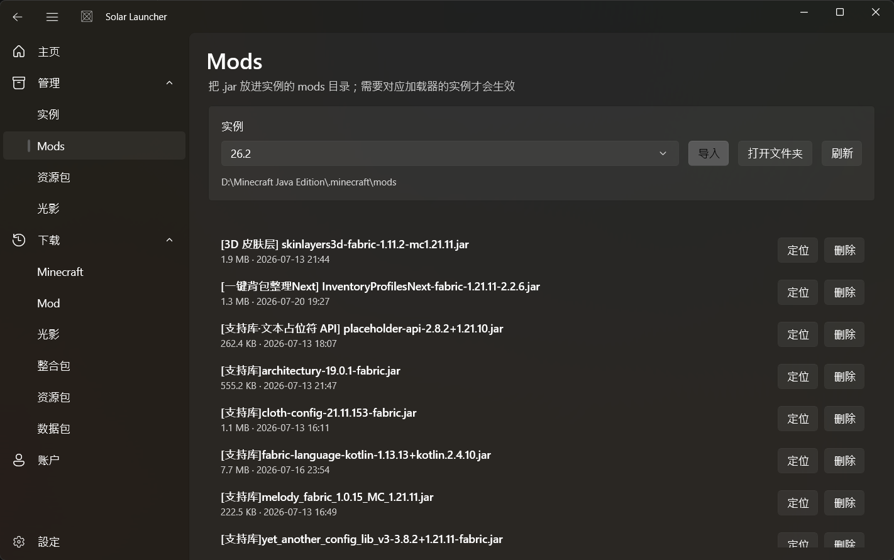
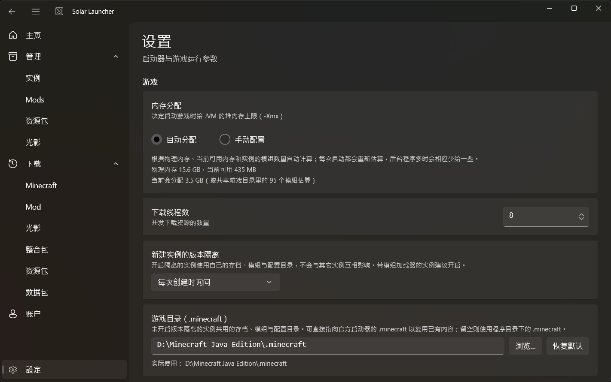
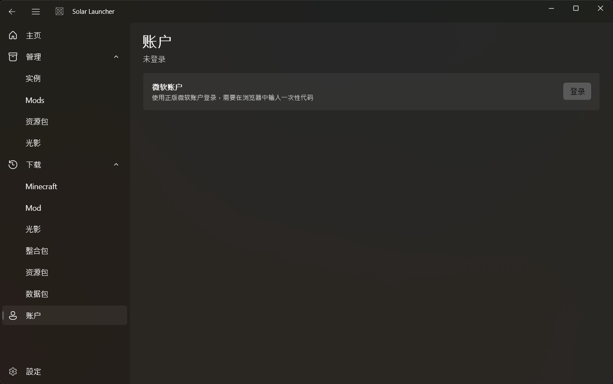

<div align="center">


# ☀️ Solar Launcher

**一个用 WinUI 3 写的现代 Minecraft 启动器**

原生 Windows 11 界面 · 便携免安装 · 版本隔离 · 微软正版登录

[English](README.md) · **简体中文**

[](https://dotnet.microsoft.com/)
[](https://learn.microsoft.com/windows/apps/winui/winui3/)
[](../../releases)
[](#-快速开始)

[下载](../../releases) · [功能](#-功能) · [截图](#-截图) · [开发](#-开发) · [当前进度](#-当前进度)

</div>



---

## ✨ 功能

### 🎮 版本管理
每个版本可独立选择游戏版本与加载器，互不干扰。MC 文件夹里已有的版本会**自动列出**，不必重新下载。

从下载页点一个版本就能直接进入创建流程，把加载器、OptiFine、Fabric API 这些组件一次装好。

| 版本列表 | 创建版本 |
| :---: | :---: |
|  |  |

### 📦 版本隔离
对齐 PCL：一个版本文件夹就是一个版本，开启隔离后它同时就是**游戏目录**
（`.minecraft/versions/<版本id>`），存档、模组与配置都放在里面。
可以同时放一个 Fabric 版本和一个 Forge 版本而互不冲突。

切换隔离只改一个开关，不会搬动已有文件；开启时可以选择把 MC 文件夹根下的
`mods` / `config` / `saves` / `resourcepacks` 复制一份过去，目标已存在的文件不会覆盖。

`assets` 与 `libraries` 始终共享，不受隔离影响。版本设置写在
`versions/<id>/.solar/version.json`，跟随版本文件夹一起搬移。



### 🚀 启动与进度
点启动后，启动按钮展开为底部的进度卡片：步骤条按「解析版本 → 补装依赖 → 安装加载器 → 启动游戏」
逐项推进，下载阶段显示当前文件、已完成数量与总体进度。失败原因直接写在卡片里，
可以重试或取消，不再弹窗挡住细节。一个版本都没有时点启动，卡片会提示先创建版本。

下载与启动进度同步显示在任务栏进度条上，进入启动阶段时闪烁任务栏提醒。
游戏窗口真正出现后，启动器按「设置 → 游戏启动后」保持不动（默认）、最小化或关闭；
如果游戏进程提前退出，启动器保持可见并显示错误。

### ⚙️ 设置
设置页集中管理游戏目录、新建版本的隔离默认值、Java 路径、下载源与「游戏启动后」行为。
有未保存的修改时离开页面会询问「保存 / 不保存 / 取消」，底部「重置」可把所有项恢复默认值，
保存后生效。

### ⬇️ 下载
版本列表来自 Mojang 官方清单，支持按版本号搜索，按版本类型（正式版 / 快照 / 预发布版 / 远古 Beta / Alpha）与发布年份筛选，选中即可创建版本。



「下载」下另外五个分区都从 Modrinth 与 CurseForge 搜索，共用同一套详情页与安装对话框：

| 分区 | 搜索过滤 | 安装落点 |
| --- | --- | --- |
| **Mod** | 该版本的游戏版本 + 加载器 | 该版本的 `mods/`，安装时把必选前置一起装好 |
| **光影** | 该版本的游戏版本 | 该版本的 `shaderpacks/` |
| **整合包** | 用户选的游戏版本 | **新建一个隔离版本**，把整包文件全部下好 |
| **资源包** | 该版本的游戏版本 | 该版本的 `resourcepacks/` |
| **数据包** | 该版本的游戏版本 | 选定存档的 `saves/<存档>/datapacks/` |

顶部选定的版本同时决定版本与加载器筛选，搜出来的每一条都能直接装。
没选版本也能浏览，只是安装按钮会提示先创建版本。整合包是例外——它自带
Minecraft 版本与加载器，安装时创建一个隔离的版本文件夹，游戏本体与加载器当场装好。

点进详情能看到正文、截图与全部历史版本。数据包在安装对话框里还要选一个存档；
没有存档时会明确提示先在游戏里创建世界。

| Mod 列表 | Mod 详情 |
| :---: | :---: |
|  |  |

### 🧩 模组加载器
支持 **Fabric / Quilt / Forge / NeoForge** 四大加载器，以及 **OptiFine**、**LiteLoader**、**Fabric API**、**OptiFabric** 等附加组件。

| 加载器 | 安装方式 |
| --- | --- |
| Fabric / Quilt | 元数据接口直接返回带 `inheritsFrom` 的 profile JSON |
| Forge / NeoForge | 下载 installer jar，取出 `version.json`，再执行客户端 processor |
| OptiFine | 解析安装器，生成 launchwrapper profile |
| LiteLoader | 解析安装器，注入 tweakClass |

Forge / NeoForge 的 installer 不是简单解压：它要跑若干 processor（重命名原版 jar、打二进制补丁）
才能产出可用的 client artifact。这些 processor 用 Java 执行，参数里混有三种占位符形态 ——
`{KEY}` 引用数据表、`[group:artifact:version@ext]` 内联 maven 坐标、`'literal'` 单引号字面量，
全部在 `LoaderInstaller` 里处理。

加载器在**创建版本时**就装好；只有中途失败或取消留下的版本，才会在首次启动时补装。

### 🗂️ 内容管理
「管理」下直接读写 MC 文件夹根下的内容目录（暂不按版本区分，按版本管理留作后续）：

| 子项 | 内容 |
| --- | --- |
| **版本** | 创建 / 重命名 / 删除版本，进入单个版本的设置 |
| **Mods** | `mods` 目录里的 jar |
| **资源包** | `resourcepacks` 目录里的 zip 或解压后的文件夹 |
| **光影** | `shaderpacks` 目录里的 zip 或解压后的文件夹 |

不维护额外索引 —— 手动往里放文件，刷新就能看到。页面里可以导入文件 / 文件夹、
在资源管理器中定位、删除。



### 🧠 内存分配
**自动模式**根据物理内存、当前可用内存和该版本的模组数量计算堆上限，每次启动重新估算，
后台程序多时自动少给一些。也可以切到**手动模式**用滑条指定。

### 🔐 微软正版登录
只支持微软正版账户，不提供离线登录。

登录走 OAuth **设备码流程**：点「登录」后启动器显示一次性代码，同时复制到剪贴板、
用默认浏览器打开 `microsoft.com/link`，粘贴确认即可，无需内嵌浏览器。支持多账户与令牌静默刷新。

令牌链（OAuth → Xbox Live → XSTS → Minecraft Services）由
[CmlLib.Core.Auth.Microsoft](https://github.com/CmlLib/CmlLib.Core.Auth.Microsoft) 完成。
`%APPDATA%\SolarLauncher\accounts.json` 只存用户名、UUID、XUID 等展示信息，**不含任何令牌**；
令牌在 `%APPDATA%\SolarLauncher\msa-accounts.json`。

> **客户端 ID 已内置**：启动器随包分发自己的 Azure 应用 ID，登录无需任何配置。
> 详见下方[账户配置](#账户配置)。

### 🚀 下载引擎与镜像
依赖下载使用 [CmlLib.Core](https://github.com/CmlLib/CmlLib.Core) 的 `ParallelGameInstaller`：
它用 TPL Dataflow 把「校验」和「下载」分成两级流水线，各自独立并行度，内置 SHA1 校验与背压。
版本解析、参数拼装、进程启动全部是 `Solar.Core` 自己的实现。

镜像通过 `MirrorRewritingHandler` 在 HTTP 层重写 URL：只重写 `libraries.minecraft.net`（→ `/maven/`）
与 `resources.download.minecraft.net`（→ `/assets/`），`piston-data` 等路径保持直连，
因为镜像对它们的支持不完整。

模组源默认走 **MCIM 镜像**（`mod.mcimirror.top`），它同时代理 Modrinth 与 CurseForge ——
后者不需要 API Key，这是国内可用 CurseForge 的唯一途径。

---

## 🖼️ 截图

| 设置 | 账户 |
| :---: | :---: |
|  |  |

> 界面遵循 WinUI 3 官方规范：标题栏用 `TitleBar` 控件，导航用 `NavigationView`，
> 颜色全部取自 `ThemeResource`（自动适配浅色 / 深色 / 高对比度），窗口材质为 `MicaBackdrop`。
> 上面截图是深色主题。

---

## 🧱 技术栈

| 层 | 技术 |
| --- | --- |
| UI | WinUI 3 / Windows App SDK 1.8，非打包便携版 |
| 架构 | MVVM（CommunityToolkit.Mvvm）+ 构造函数依赖注入 |
| 核心 | .NET 8 类库 `Solar.Core`，与 UI 完全解耦 |
| 下载 | CmlLib.Core `ParallelGameInstaller`（只用下载部分） |
| 内容下载 | Modrinth / CurseForge（经 MCIM 镜像）；Mod / 光影 / 整合包 / 资源包 / 数据包 |
| 整合包 | 解析 `.mrpack` / CurseForge manifest，创建隔离版本并下载整包 |
| Markdown | 详情正文只用到极简解析器（标题 / 粗体 / 列表 / 链接） |
| 登录 | CmlLib.Core.Auth.Microsoft（OAuth 设备码 + MSAL.NET） |
| 测试 | xUnit（`tests/Solar.Core.Tests`），390 个测试 |

```
src/
  Solar.Core/            核心层，无 UI 依赖
    Paths/               AppPaths：所有目录集中管理；游戏资源在 exe 所在目录，
                         配置与账户在 %APPDATA%\SolarLauncher
    Json/                统一 JSON 选项、原子写入、参数数组转换器
    Models/              Mojang 版本 JSON 模型、rules 求值
    Minecraft/           版本清单下载与缓存、版本 JSON 解析与 inheritsFrom 合并
    Versions/            版本模型、仓库、扫描与创建流程
    Content/             版本游戏目录里的 Mods / 资源包 / 光影 读写
    Mods/                在线内容目录（Modrinth / CurseForge）、依赖解析、文件下载与安装
    Modpacks/            整合包解析（mrpack / CurseForge manifest）与整包安装
    Loaders/             Fabric / Quilt / Forge / NeoForge 安装
    Addons/              OptiFine / LiteLoader / Fabric API / OptiFabric
    Download/            依赖下载与镜像重写
    Launch/              启动参数拼装与游戏进程启动
    Memory/              内存自动分配
    Accounts/            微软登录与账户存储
    Java/                Java 探测与版本选择
    Settings/            全局设置
  Solar.App/             WinUI 3 界面层
    Services/            导航服务、对话框服务
    ViewModels/          各页面视图模型
    Views/               页面（PageBase 统一处理 DataContext 与加载）
    Converters/          XAML 值转换器
tests/
  Solar.Core.Tests/      核心层单元测试
tools/                   端到端验证工具（见下）
```

---

## 🚀 快速开始

### 直接使用

从 [Releases](../../releases) 下载最新构建，解压到任意目录，双击 `SolarLauncher.exe`。

程序免安装：游戏资源写在 exe 所在目录，**配置、账户与日志在 `%APPDATA%\SolarLauncher`**，
所以换一个程序副本仍是同一份登录状态；删掉 exe 所在的文件夹即可卸载，
再手动删掉 `%APPDATA%\SolarLauncher` 就什么都不剩了。
Windows App SDK 以自包含方式随输出分发；仍需安装 **.NET 8 Desktop Runtime**。

> 解压即用：微软登录所需的客户端 ID 已内置，无需任何前置配置。见[账户配置](#账户配置)。

### 从源码构建

要求：**.NET 8 SDK**、Windows 10 1809 及以上。

```bash
git clone https://github.com/CakewthinSUm/Solar_Launcher.git
cd Solar_Launcher
dotnet build SolarLauncher.sln
dotnet run --project src/Solar.App
```

---

## 📁 目录布局

数据分两处存放：

```
%APPDATA%\SolarLauncher\   启动器自己的配置、账户、日志与缓存
                           （settings.json / accounts.json / logs / 版本清单与 Mod 缓存）
<exe 所在目录>\.minecraft\  MC 文件夹（设置里可改，也可指向官方启动器的目录）
├── versions\<id>\         版本文件夹；开启隔离时它就是游戏目录
│   ├── <id>.json / <id>.jar
│   └── .solar\            该版本的设置与原生库
│       ├── version.json
│       └── natives\
├── libraries\             共享库
├── assets\                共享资源
└── runtime\               自动下载的 Java 运行时
```

与 PCL 一致：一个版本文件夹就是一个版本，没有额外的实例记录或索引文件。
版本设置写在 `versions\<id>\.solar\version.json`，跟着版本文件夹一起搬移。
未开启隔离的版本使用 MC 文件夹根作为游戏目录；开启后使用自己的版本文件夹。
把 MC 文件夹指向官方启动器的 `.minecraft` 就能直接复用已有的模组与存档。

---

## ⚙️ 账户配置

客户端 ID 是**应用**的属性，不是用户的：Solar Launcher 已经把自己在 Azure 注册的
应用 ID 内置在 `AuthOptions.DefaultClientId` 里，随程序分发。它有两点值得说明：

- 它是公开信息，不是密钥，放在客户端里是微软推荐的做法；
- 它决定了 Minecraft 服务认不认这个应用，所以必须用**本启动器自己**注册的那个，
  不能借用别的启动器 / 第三方注册的 ID（那违反微软的使用条款）。

普通用户**不需要做任何配置**：打开启动器 → 「账户」→ 登录即可。

想改用自己注册的应用（例如二次开发、fork 后自建），需要：

1. 在 [Azure 门户](https://portal.azure.com) 注册应用
2. 应用类型选「移动和桌面应用」，启用「允许公共客户端流」
3. 重定向 URI 填 `http://localhost`
4. 在 [aka.ms/mce-reviewappid](https://aka.ms/mce-reviewappid) 提交审核
   （否则调用 Minecraft API 会返回 403）
5. 把客户端 ID 写进 `AuthOptions.DefaultClientId`
   （`src/Solar.Core/Accounts/MicrosoftAuthService.cs`）

客户端 ID 不作为设置项暴露给用户，也不需要用户填写。

---

## 🆕 更新日志

### 0.1.1-beta

- 启动按钮展开为底部进度卡片：分阶段步骤条、当前文件与总体进度、取消与失败重试
- 无版本时点启动，提示移入卡片并带展开 / 收起动画
- 下载与启动进度同步到任务栏，进入启动阶段时闪烁提醒
- 设置新增「游戏启动后」：保持不动 / 最小化 / 关闭启动器，等游戏窗口真正出现后执行
- 离开设置页时提示保存未保存的修改，底部新增「重置」
- 修复微软登录点击无响应（设备码回调跨线程更新 UI），验证码自动复制并打开验证页
- 下载页支持按版本类型与发布年份筛选
- 补齐光影 / 整合包 / 资源包 / 数据包在线下载，并接入 Mod 下载界面
- 内置 Azure 客户端 ID，登录不再需要手动配置

---

## 🛠️ 开发

```bash
# 构建与测试
dotnet build SolarLauncher.sln
dotnet test tests/Solar.Core.Tests/Solar.Core.Tests.csproj

# 运行
dotnet run --project src/Solar.App
```

### 端到端验证工具

`tools/` 下每个探针都验证一条真实链路，不需要 UI：

```bash
# 真实下载一个版本的全部依赖（不需要登录）
dotnet run --project tools/Solar.Smoke -- 1.21.4 %TEMP%\solar-smoke --prepare-only

# 下载并启动，60 秒后若仍在运行则判定成功（需要先登录）
dotnet run --project tools/Solar.Smoke -- 1.21.4 %TEMP%\solar-smoke

# 验证微软登录全流程：设备码 → Xbox → XSTS → Minecraft → 静默刷新
dotnet run --project tools/Solar.AuthProbe -- <你的客户端ID>

# 验证加载器安装（不给版本号则列出可选项并选最新）
dotnet run --project tools/Solar.LoaderProbe -- fabric 1.21.4
dotnet run --project tools/Solar.LoaderProbe -- forge 1.21.4 54.1.22

# 验证装好的加载器版本能否真正启动（用合成账户，不需要登录）
dotnet run --project tools/Solar.LaunchProbe -- fabric-loader-0.20.1-1.21.4
dotnet run --project tools/Solar.LaunchProbe -- 1.21.4-forge-54.1.22

# 验证在线内容数据层（搜索 / 详情 / 依赖清单 / 真实下载安装）
dotnet run --project tools/Solar.ModProbe -- search sodium fabric 1.21.4
dotnet run --project tools/Solar.ModProbe -- search complementary 1.21.4 --type=shader
dotnet run --project tools/Solar.ModProbe -- detail modrinth AANobbMI fabric 1.21.4
dotnet run --project tools/Solar.ModProbe -- detail modrinth OhduvhIc 1.21.4 --type=datapack
dotnet run --project tools/Solar.ModProbe -- plan modrinth PtjYWJkn fabric 1.21.4
dotnet run --project tools/Solar.ModProbe -- install curseforge 394468 fabric 1.21.4

# 下载并解析一个整合包，打印它的 MC 版本、加载器与文件清单（不安装）
dotnet run --project tools/Solar.ModProbe -- modpack modrinth 1KVo5zza 1.21.4
dotnet run --project tools/Solar.ModProbe -- modpack curseforge 396246 1.21.4
```

排查网络问题时加 `SOLAR_PROBE_VERBOSE=1` 可以看到每次换源的详细原因。

---

## 🗺️ 当前进度

- [x] 项目骨架、DI、MVVM、导航
- [x] 版本创建 / 删除 / 列表，持久化到磁盘
- [x] 版本清单拉取与本地缓存（可在设置中换成国内镜像）
- [x] 版本 JSON 下载、`inheritsFrom` 合并、rules 平台求值
- [x] Java 自动探测与版本匹配
- [x] 依赖（libraries / assets / natives）下载与 SHA1 校验
- [x] 启动参数拼装与游戏进程启动
- [x] 启动进度卡片（分阶段步骤条、下载详情、取消与失败重试）
- [x] 任务栏下载进度与完成闪烁
- [x] 下载镜像（BMCLAPI）与按版本覆盖 Java / 内存
- [x] 微软正版登录（设备码流程、多账户、令牌静默刷新）
- [x] 模组加载器安装（Fabric / Quilt / Forge / NeoForge）
- [x] OptiFine / LiteLoader / Fabric API / OptiFabric 附加组件
- [x] 版本隔离（版本文件夹作为游戏目录，可把共享内容复制过来）
- [x] 「管理」下的 Mods / 资源包 / 光影 列表、导入、删除
- [x] 内存分配：自动按物理内存 / 可用内存 / 模组数量计算，或手动用滑条指定
- [x] 游戏目录版本扫描与一键导入
- [x] 下载页选版本 → 一次装完加载器与附加组件
- [x] 在线内容数据层（Modrinth + CurseForge 双源、跨源去重、依赖解析、SHA1 校验安装）
- [x] 内容下载界面（Mod / 光影 / 整合包 / 资源包 / 数据包 共用搜索、详情与安装对话框）
- [x] 光影与资源包在线下载（按版本的游戏版本过滤，装进对应目录）
- [x] 数据包在线下载（按存档安装到 `saves/<存档>/datapacks/`）
- [x] 整合包在线下载与安装（解析 `.mrpack` / CurseForge manifest，新建隔离版本，下载全部文件并解压 overrides）
- [x] 下载页版本筛选（版本类型 + 发布年份）
- [x] 启动后窗口行为（保持 / 最小化 / 关闭），设置页未保存提示与重置
- [ ] 已装内容的管理与更新检查（按 SHA1 反查项目、启用/禁用、更新）
- [ ] 启动器自更新（检查 GitHub Releases，下载并应用更新）
- [ ] 网络诊断（下载源测速）
- [ ] 版本导出为整合包

### 内容下载设计

数据层在 `Solar.Core/Mods/`，两个源统一成同一套模型，UI 层不需要为不同内容类型分支。
`ModProjectType` 负责把类型翻译成两个源各自的标识和安装落点：

| 类型 | Modrinth `project_type` | CurseForge `classId` | 安装落点 |
| --- | --- | --- | --- |
| Mod | `mod` | 6 | `mods/` |
| 整合包 | `modpack` | 4471 | 新建隔离版本 |
| 资源包 | `resourcepack` | 12 | `resourcepacks/` |
| 光影 | `shader` | 6552 | `shaderpacks/` |
| 数据包 | `datapack` | 6945 | `saves/<存档>/datapacks/` |

| 能力 | 说明 |
| --- | --- |
| 数据源 | Modrinth 与 CurseForge，默认走 MCIM 镜像 |
| 降级 | 两源并行，任一不可用仍返回另一边的结果，并在结果里标出失败的源 |
| 去重 | 同类型 + 同名 + 加载器有交集 + 更新时差 ≤7 天 视为同一项目，保留 CurseForge 那条 |
| 依赖 | 只有 Mod 递归展开必选前置（深度上限 5，带环检测），可选前置只展示 |
| 安装 | 写入版本实际使用的目录，保留上游文件名，SHA1 校验后原子落盘 |

两个类型特有的坑：

- **数据包**在 Modrinth 上没有独立的项目类型，同一个项目常常既有 Mod jar 版本、
  又有 `.zip` 数据包版本。版本请求会额外带上 `loaders=["datapack"]`，否则列表里会混进 jar。
- **光影 / 资源包 / 整合包**不参与加载器筛选。把 `categories:fabric` 或
  `modLoaderType` 带上去会直接搜空。

整合包在 `Solar.Core/Modpacks/`。安装时先下载整包、解析 manifest，再新建一个隔离版本：

| 格式 | 解析方式 |
| --- | --- |
| Modrinth `.mrpack` | 读 `modrinth.index.json`，跳过 `env.client = "unsupported"` 的条目 |
| CurseForge | 读 `manifest.json`，逐条用 `projectID/fileID` 查下载地址（镜像免 Key） |

文件按 manifest 里的相对路径下载并做 SHA1 校验；`overrides/` 与 `client-overrides/`
解压进版本目录（两者都有时客户端专用版本覆盖前者）。路径会做 zip-slip 校验，
拒绝 `../`、绝对路径与盘符。游戏本体与加载器**不在安装时下载**——版本首次启动
会走 `GameLaunchService` 的补装流程，避免一次操作里同时跑两套下载器。

与 PCL 的取舍：**不做**中文词表搜索（只支持英文/原名）；版本列表用服务端的
`gameVersion` + `modLoaderType` 过滤而不是一次拉全量；Mod 安装时会把必选前置一并装好；
CurseForge 整合包的文件统一放进 `mods/`（manifest 不带目标目录，社区约定如此）。
详见 [docs/mod-download-design.md](docs/mod-download-design.md) 与
[docs/addon-download-design.md](docs/addon-download-design.md)。

界面在「下载 → Mod / 光影 / 整合包 / 资源包 / 数据包」：顶部选目标版本
（整合包改为选游戏版本），搜索后点一行进详情，选版本点安装。数据包在对话框里
选择存档；整合包在对话框里给版本起名并显示将下载的文件数/体积。
内容源（官方 / 镜像 / CurseForge Key）在「设置 → 下载源」里改，换源会自动清掉旧缓存。

---

## 📄 说明

本项目与 Mojang Studios / Microsoft 无关联。Minecraft 是 Mojang Studios 的商标。
使用正版账户登录，请遵守 [Minecraft 最终用户许可协议](https://www.minecraft.net/eula)。
